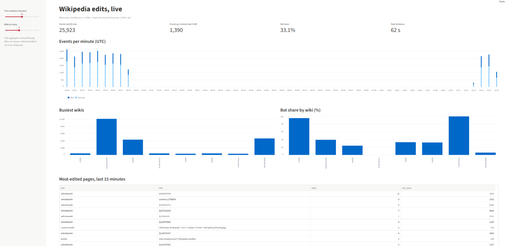
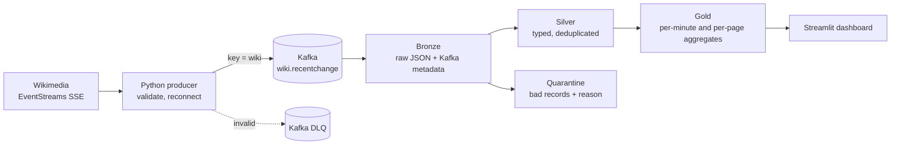

# Wikipedia Edits Streaming Pipeline

<!--[](https://github.com/gashndolo/wiki-streaming-pipeline/actions/workflows/ci.yml) -->

A real-time pipeline that ingests Wikimedia's live edit feed into Kafka, processes it with Spark Structured Streaming into Delta Lake tables (bronze, silver, gold), and serves near-real-time aggregates on a Streamlit dashboard: edits per minute by wiki, bot vs human activity, and the most-edited pages.

**Stack:** Python · Apache Kafka (KRaft) · Spark Structured Streaming 4.0 · Delta Lake 4.0 · Streamlit · Docker Compose · GitHub Actions



## Results at a glance

| | |
|---|---|
| Source load | ~33 events/s measured (~2.9M/day) from the live Wikimedia feed |
| Producer reliability | 8,623 events published, 8,623 delivered, 0 errors; survived a Kafka outage with 0 delivery errors |
| Exactly-once ingestion | `kill -9` mid-stream on bronze: 66,806 rows, **0 duplicates, 0 gaps** across all Kafka partitions |
| Stateful recovery | `kill -9` on silver: dedupe state restored from checkpoint (52,083 → 52,597 keys), **0 duplicate event IDs** afterwards |
| Gold correctness | Per-minute counts in gold equal counts recomputed from silver: 496,657 vs 496,657 events, **0 mismatched keys**, 0 duplicate keys |
| Compaction | Bronze 846 files → 1, silver 484 files → 1 |
| Event time to silver | p50 46 s, p95 60 s (two 30 s micro-batch stages) |

## Architecture



Bronze, silver, quarantine and gold are Delta tables. All streaming queries run in one Spark application (`spark_jobs/pipeline.py`) so they fit in ~7 GB of memory.

| Layer | What it holds | Key behavior |
|---|---|---|
| Producer | Reads the SSE feed, publishes raw JSON keyed by wiki | Idempotent producer, `acks=all`, reconnect with exponential backoff and `Last-Event-ID` resume, invalid events to a dead-letter topic |
| Bronze | Raw JSON exactly as received, plus Kafka partition, offset, timestamp | Append-only; a parsing bug never loses data |
| Silver | Typed columns, one row per event | Explicit schema, validation, dedupe on `meta.id` within a 10-minute watermark |
| Quarantine | Invalid rows with the original payload and a reason | Nothing is silently dropped |
| Gold | `edits_per_minute`, `edits_by_page_5min` | 1-minute and 5-minute event-time windows, 5-minute watermark, upserts via `MERGE` |

## Key design decisions

**Message key = wiki.** Keeps each wiki's events ordered within a partition. Trade-off, measured: the three partitions held 38.5%, 52.1% and 7.2% of events, because a few huge wikis dominate. Order doesn't matter for the window aggregations, so a different key would balance better; this was kept deliberately and documented.

**Bronze is raw.** Parsing happens in silver, so schema or parsing bugs are fixed by replaying bronze rather than re-ingesting.

**Exactly-once by two mechanisms.** Spark checkpoints record Kafka offsets per batch, and Delta records the streaming batch ID in its transaction log, so a replayed batch isn't written twice. Verified by killing the job.

**Validation with a quarantine table.** Rules: unparseable JSON, missing event ID, wiki, type or timestamp, and implausible timestamps (before 2001 or more than a day ahead). Injecting bad messages on purpose exposed a real bug: malformed JSON was labelled `missing_event_id` because `from_json` returns a struct of nulls rather than null. The fix is covered by a unit test.

**Dedupe with a watermark.** A streaming job can't remember every ID forever, so silver remembers 10 minutes. Duplicates arriving later than that aren't caught; this is the documented trade-off.

**Update mode plus MERGE for gold.** Append mode would publish a window only after the watermark passes. Instead each batch upserts the current total for each changed window, so the live minute fills in and replays after a crash give the same result.

**Privacy.** For unregistered editors the user field is an IP address. The dashboard shows only aggregates and public page titles, never individual editors.

## Verification

All numbers below are in `docs/metrics.md` with how they were measured.

| Test | Result |
|---|---|
| Bronze crash (`kill -9`) | 66,806 rows, 0 duplicates, 0 gaps; batch numbering continued from the checkpoint; first recovered batch read 7,688 rows |
| Silver crash (`kill -9`) | Dedupe state survived the restart; 0 duplicate event IDs |
| Dedupe injection | A valid event sent twice appears once in silver |
| Quarantine injection | 1970 timestamp and missing `type` routed with the correct reasons |
| Gold vs silver reconciliation | 496,657 = 496,657 events, 0 mismatched (minute, wiki) keys, 0 duplicate keys, windows older than 10 minutes |
| Kafka outage (producer) | Broker stopped mid-run and restarted; 0 delivery errors |

**Latency** (measured on the earlier separate bronze and silver jobs): Kafka to bronze batch start p50 14.9 s, p95 28.7 s; event time to silver p50 46 s, p95 60 s. Gold last updated 57 s before one check, and its commits were roughly a minute apart while a verification job competed for CPU, so "about a minute" is the safe claim.

**Observed bot share:** 33.0% over a 13-minute live window (9,278 of 28,155 events). A 10-minute snapshot by wiki: enwiki 16.7%, wikidatawiki 20.3%, commonswiki 38.3%, trwiktionary 99.1%. These are snapshots, not long-run averages.

## Compaction

Streaming writes a small file per micro-batch. `OPTIMIZE` fixed it:

| Table | Files before → after | Active size |
|---|---|---|
| Bronze | 846 → 1 | 138.5 → 134.3 MB |
| Silver | 484 → 1 | 35.0 → 30.5 MB |

(One file per daily partition.) Gold tables stayed small on their own (3 and 2 files), because each MERGE rewrites the files it touches, so there was nothing to compact.

## Incidents and lessons

- **`VACUUM` at zero retention broke downstream streams.** After compaction I vacuumed with retention 0 while silver and quarantine still pointed at old bronze files, producing `FILE_NOT_EXIST`. Recovered by rebuilding the downstream layers from bronze. Lesson: zero-retention vacuum is only safe once every downstream stream has fully drained; production should keep the 7-day default.
- **Spark 4.1.0 Kafka source NullPointerException.** The bronze query crashed in `KafkaMicroBatchStream.metrics`, a known upstream regression in the 4.1 line (SPARK-57438). No data was damaged. Pinned Spark and Delta to 4.0.1 and rebuilt all layers from Kafka. Lesson: pin versions deliberately and check issue trackers before blaming your own state.

## Run it

Prerequisites: Docker with Compose v2 (about 7 GB available memory), Python 3.12, Java 17 for local Spark runs.

```bash
git clone https://github.com/gashndolo/wiki-streaming-pipeline.git
cd wiki-streaming-pipeline
cp .env.example .env          # set WIKI_USER_AGENT to a descriptive name with contact details
```

**Everything in Docker:**

```bash
docker compose --profile app build
docker compose --profile app up -d
# dashboard: http://localhost:8501   Kafka UI: http://localhost:8082
```

The first start downloads Spark jars and replays the Kafka backlog, so give it a few minutes.

**Locally:**

```bash
python3 -m venv .venv && source .venv/bin/activate
pip install -r requirements-dev.txt -r requirements-dashboard.txt
docker compose up -d kafka kafka-init
python -m producer.run                       # terminal 1
python -m spark_jobs.pipeline                # terminal 2
python -m streamlit run dashboard/app.py     # terminal 3
```

Verification scripts: `python -m scripts.verify_bronze`, `verify_silver`, `verify_gold`; test injectors: `inject_test_events`, `inject_late_events`; compaction: `python -m spark_jobs.maintenance` (stop the pipeline first).

## Tests and CI

Unit tests (`pytest`) run the transformations on a local Spark session with no Kafka or network, including a regression test for the malformed-JSON bug. GitHub Actions runs lint, a compile check, the tests, and a compose-file validation on every push.

CI does not run Kafka or the streaming jobs, and does not test gold's aggregation or MERGE logic. Streaming behavior was verified locally with the crash tests and verification scripts above.

## Known limitations

- Single-node Kafka and local Spark: this demonstrates the patterns, not production scale.
- Late-data handling is implemented (5-minute watermark in gold) but was not conclusively verified end to end, so it isn't claimed as a result.
- Whole-pipeline crash recovery for gold was not separately tested.
- Latency figures come from the earlier separate-jobs setup, not the combined application.
- No cloud sink; tables live on local disk or Docker volumes.

## Repository layout

```
producer/       SSE reader, validation, Kafka producer
spark_jobs/     bronze, silver, gold, pipeline runner, maintenance
dashboard/      Streamlit app (reads gold with the deltalake library, no Spark)
scripts/        verification and test-injection scripts
tests/          unit tests
docs/           screenshots and metrics log
```

## Acknowledgements

Edit events from [Wikimedia EventStreams](https://stream.wikimedia.org/). Wikimedia asks API clients to identify themselves with a descriptive User-Agent.